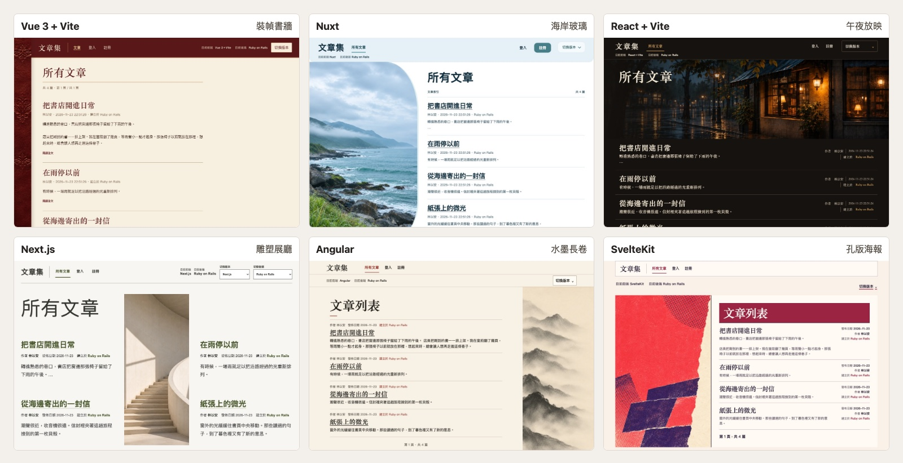

# 文章集｜AI-workflow-fullstack

文章集是可在本機操作的會員文章與留言網站，用來比較不同框架如何實作同一套功能。**六種前端與十三種後端可獨立切換，共 78 種搭配。** 所有搭配透過同一份 API 契約讀寫同一個 PostgreSQL 資料庫。

[使用技術](#使用技術) · [本機啟動](#本機啟動) · [如何測試](#如何測試)



*六種版型的實際畫面，使用同一批合成文章。*

## 主要功能

- **公開閱讀與帳號**　訪客可直接瀏覽公開文章及留言。網站提供會員註冊、登入與登出。
- **發文與留言**　會員可發表純文字文章和留言，並編修、下架或恢復自己的內容。
- **後台管理**　管理員可搜尋會員、停用或恢復帳號、管理文章與留言，並調整登入失敗鎖定規則。
- **自由切換前後端**　工具列分別顯示目前使用的前端與後端。可為同一篇文章換版型，也可保留版型改用另一個 API 後端。

## 使用技術

### 六種前端

六版共用 Node.js 24.21.0 作為容器建置環境。NGINX 將六版放在同一個入口 `http://localhost:8080` 下。

| 前端 | 技術 | 視覺風格 | 頁面路徑 |
| --- | --- | --- | --- |
| Vue 3 + Vite | JavaScript、Vue 3 單檔元件、Vite | 裝幀書牆 | `/vue/` |
| Nuxt | JavaScript、Vue 3、Nuxt 4 | 海岸玻璃 | `/nuxt/` |
| React + Vite | JavaScript、JSX、React 19、Vite | 午夜放映 | `/react/` |
| Next.js | JavaScript、JSX、React 19、Next.js 16 App Router | 雕塑展廳 | `/next/` |
| Angular | TypeScript、Angular 21、Angular CLI | 水墨長卷 | `/angular/` |
| SvelteKit | JavaScript、Svelte 5、SvelteKit 2、Vite、Node adapter | 孔版海報 | `/sveltekit/` |

### 十三種後端

| 後端 | 語言與容器執行環境 | API 基底位址 |
| --- | --- | --- |
| Laravel | PHP 8.4 | `http://localhost:8081` |
| Symfony | PHP 8.4 | `http://localhost:8082` |
| ASP.NET Core Controllers | C#、.NET 10 | `http://localhost:8083` |
| Django | Python 3.13 | `http://localhost:8084` |
| Flask | Python 3.13 | `http://localhost:8085` |
| FastAPI | Python 3.13 | `http://localhost:8086` |
| Gin | Go 1.26 | `http://localhost:8087` |
| Echo | Go 1.26 | `http://localhost:8088` |
| Fiber | Go 1.26 | `http://localhost:8089` |
| Express | JavaScript、Node.js 24 | `http://localhost:8090` |
| Fastify | JavaScript、Node.js 24 | `http://localhost:8091` |
| NestJS | JavaScript、Node.js 24 | `http://localhost:8092` |
| Ruby on Rails | Ruby 4.0 | `http://localhost:8093` |

### 共用資料庫與 API

Docker Compose 啟動六個前端、十三個後端、NGINX 1.30 與 PostgreSQL 18。十三個後端提供相同的 22 個 API 操作，共用帳號、文章、留言與登入鎖定設定。資料庫結構由集中維護的版本化 SQL 更新。 [系統架構](docs/architecture.md) · [API 文件](docs/article-api.md)

## 前後端如何切換

在工具列分別選擇前端與後端。各版透過「切換版本」面板或直接顯示選單。首次開啟網站使用 Vue 3 + Vite 與 Laravel。

| 操作 | 切換後的行為 |
| --- | --- |
| **換前端** | 同一分頁會開啟對應頁面，並保留目前後端與有效登入。登入期限沿用原到期時間。例如 `/vue/articles/101` 切到 Nuxt 後會開啟 `/nuxt/articles/101`。 |
| **換後端** | 保留目前前端並清除舊憑證。接下來要使用會員或管理功能時，請用原帳號重新登入。各後端只接受自己簽發的 JWT，既有的登入鎖定也會在新後端生效。 |

### 切換限制

- **瀏覽環境**　登入延續與版本選擇以同一個瀏覽器分頁為限，需要瀏覽器允許分頁儲存。請使用 `http://localhost:8080` 作為展示入口。
- **頁面與權限**　對應頁面限六版支援的路徑與有效的資源 ID。目標會重新讀取資料並驗權，權限不足或資料不可用時會顯示對應狀態。
- **列表與草稿**　列表頁碼、搜尋條件和捲動位置會從目標頁的初始狀態開始。遇到草稿提示時可取消切換，或捨棄草稿後繼續。已送出的請求仍可能完成，切換後請以重新讀取的結果為準。
- **連線失敗**　目標服務未就緒或連線失敗時，可手動重試或返回上一頁。

[前後端選擇與頁面對照](docs/user-guide.md#選擇畫面與後端)

## 本機啟動

準備 Git、`sh`、OpenSSL、已啟動的 Docker，以及支援 `docker compose up --wait` 的 Compose plugin。請預留本機連接埠 `8080`–`8093`，首次建置需要網路下載映像與套件。主機只需上述工具，語言環境由容器提供。啟停流程已在 macOS 實測，Linux 與 Windows WSL2 待實機驗證。

### 首次啟動

```sh
git clone https://github.com/a9088391/AI-workflow-fullstack.git &&
cd AI-workflow-fullstack &&
./ops/setup.sh
```

第一次會建立本機資料庫設定與金鑰，並提示輸入管理員 Email、暱稱及 4–16 碼 ASCII 英數密碼。等指令完成後開啟 [本機展示站](http://localhost:8080/)，預設是 Vue 3 + Vite 搭配 Laravel。空資料庫可直接註冊一般會員，也可以用剛建立的管理員登入並發表第一篇文章。

### 日常啟停與狀態查詢

以下指令各自從專案根目錄執行。

```sh
# 啟動完整展示站並等待服務就緒
./ops/start.sh

# 列出所有使用中的前後端與健康狀態
docker compose --profile '*' ps

# 停止並移除容器與 Compose 網路，保留資料卷與金鑰
./ops/stop.sh
```

既有安裝請保留 `.env` 與 `.local/keys/`。只開發 API 時可執行 `./ops/start.sh --backend-only`。Rails 暫時不可用時，執行 `./ops/start.sh --without-rails` 啟動其餘十二個後端與六版前端，修復後用一般啟動指令恢復十三版。

### 重設管理員密碼

目前的重設功能限於管理員密碼。請在 Laravel 服務就緒時，於 Bash 執行下列命令。新密碼須為 4–16 碼 ASCII 英數，重設成功後會撤銷該管理員原有的登入工作階段。 [本機維運與備份](docs/database-operations.md)

```bash
read -r -p '管理員 Email：' admin_email
read -r -s -p '新密碼：' admin_password
printf '\n'
printf '%s\n%s\n' "$admin_email" "$admin_password" | docker compose exec -T laravel php artisan app:reset-admin-password
unset admin_password admin_email
```

## 如何測試

### 瀏覽器手動驗證

1. 開啟本機展示站，註冊測試會員並登入。發表文章後進入文章詳情，新增一則留言。
2. 留在同一分頁，從工具列切換前端，確認同一篇文章、留言與登入狀態都能讀取。
3. 切換後端，確認畫面要求重新登入。登入後核對原文章與留言。
4. 登出測試會員後，用首次設定建立的管理員登入。開啟會員管理與登入鎖定設定，確認可以搜尋會員及讀取目前的設定。

[完整操作指南](docs/user-guide.md)

### 六版前端測試與建置

在主機安裝 Node.js 24.21.0 與 npm，從專案根目錄執行。各版的 `npm ci` 會依該版鎖檔安裝套件。迴圈會在第一個失敗的版本停止。

```sh
(
  set -e
  for frontend_dir in vue nuxt react next angular sveltekit; do
    printf '\n=== %s ===\n' "$frontend_dir"
    (cd "frontend/$frontend_dir" && npm ci && npm test && npm run build) || exit 1
  done
)
```

也可以只進入要驗證的版本，例如在 `frontend/vue` 執行 `npm ci && npm test && npm run build`。Nuxt 與 Angular 可另外執行 `npm run typecheck`，SvelteKit 則執行 `npm run check`。

### 後端健康檢查與驗收工具自測

完整展示站啟動後，可從專案根目錄檢查十三個後端的 `/up`：

```sh
(
  port=8081
  while [ "$port" -le 8093 ]; do
    curl -fsS --max-time 5 -o /dev/null "http://localhost:$port/up" || exit 1
    printf '%s OK\n' "$port"
    port=$((port + 1))
  done
)
```

有 Python 3.13 時，可從專案根目錄執行下列離線自測。這些指令驗證測試工具與啟停腳本的模擬流程。

```sh
python3 -B ops/tests/cq34_http.py --self-test
python3 -B ops/tests/cq34_http.py --preset rails05 --self-test
python3 -B -m unittest discover -s ops/tests -p 'perf01_test.py'
sh ops/tests/rails05_start.sh
```

### 十三版後端 HTTP 整合測試

使用 Python 3.13，先依開發指南準備並啟動 `.local/rails05-fixture` 的獨立 Compose 專案，使用專用資料卷與金鑰。這組測試會寫入合成資料，並使用 `8080`–`8093`。若展示站占用連接埠，先從展示站的專案根目錄執行 `./ops/stop.sh`，或改在另一個環境測試。準備完成後，從原專案根目錄執行下列命令，環境檢查通過後才會開始回歸。 [測試環境設定](docs/developer-guide.md#rails05-十三後端-http-回歸)

```sh
(
  set -e
  repo_root=$(pwd -P)
  cd "$repo_root/.local/rails05-fixture"
  export COMPOSE_PROJECT_NAME=rails05_test
  export COMPOSE_FILE=compose.yaml:.local/rails05-compose.yaml
  python3 -B "$repo_root/ops/tests/cq34_http.py" --preset rails05 --guard
  python3 -B "$repo_root/ops/tests/cq34_http.py" --preset rails05 --all
)
```

[開發與測試指南](docs/developer-guide.md) · [已驗證的版本與範圍](docs/verification.md)
