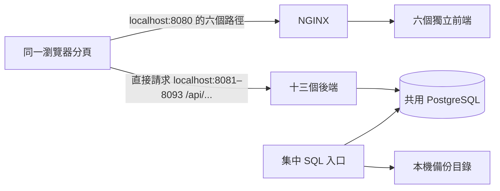

# 系統架構

本專案在一個 Docker Compose 專案中執行六個獨立前端、十三個獨立後端、單一 PostgreSQL、集中 SQL 入口和 NGINX。這是本機 demo 架構；服務僅綁定宿主機 loopback，沒有公開部署、TLS 終止或多機運轉配置。

NGINX **只轉送前端頁面及資源**；業務 API 由瀏覽器直接呼叫目前選定的後端。所有後端的方法、路徑、欄位、錯誤與資料變化遵守同一契約，前端切換後端時只更換 API 基底位址，不靠 NGINX 或框架專用轉接改寫 `/api/...`。

## 固定入口

| 前端 | 同源路徑 |
| --- | --- |
| Vue 3 + Vite | `http://localhost:8080/vue/` |
| Nuxt | `http://localhost:8080/nuxt/` |
| React + Vite | `http://localhost:8080/react/` |
| Next.js | `http://localhost:8080/next/` |
| Angular | `http://localhost:8080/angular/` |
| SvelteKit | `http://localhost:8080/sveltekit/` |

| 後端 | API 基底位址 | 後端 | API 基底位址 |
| --- | --- | --- | --- |
| Laravel | `http://localhost:8081` | Symfony | `http://localhost:8082` |
| ASP.NET Core Controllers | `http://localhost:8083` | Django | `http://localhost:8084` |
| Flask | `http://localhost:8085` | FastAPI | `http://localhost:8086` |
| Gin | `http://localhost:8087` | Echo | `http://localhost:8088` |
| Fiber | `http://localhost:8089` | Express | `http://localhost:8090` |
| Fastify | `http://localhost:8091` | NestJS | `http://localhost:8092` |
| Ruby on Rails | `http://localhost:8093` | | |

六版前端都可選十三版後端。PostgreSQL 沒有對宿主機發布連接埠。瀏覽器入口使用 `localhost`，避免混用 `127.0.0.1` 造成另一個 origin 和另一份分頁儲存狀態。

## 一次請求如何流動

1. 瀏覽器載入某個前端路徑，例如 `/react/articles/101`；NGINX 將頁面送到 React 容器。
2. 前端讀取本分頁保存的目前後端及登入資訊。公開請求可以沒有 JWT；受保護請求帶 `Authorization: Bearer ...`。
3. 瀏覽器直接向目前後端的固定 port 發送相同的 `/api/...` 路徑。後端只允許指定的 `http://localhost:8080` origin 透過 CORS 讀取回應；不使用 Cookie 認證。
4. 後端依當下帳號與資料庫狀態驗證權限，讀寫共用 PostgreSQL，回傳共同 JSON 格式。前端按錯誤碼呈現可恢復的畫面狀態。

同源的六版前端在同一分頁能延續選擇與登入；切換前端後會向目前後端重新確認身分，**不延長原本八小時到期時間**。切換後端則清除舊憑證、重新登入。這是使用體驗安排，不是六版前端之間的安全隔離；同一 origin 下的前端程式可接觸該分頁的共用儲存資料。

## 認證與授權

- 每個後端以獨立的 32-byte 金鑰簽發 HS256 JWT，`iss`／`aud` 帶 BackendId；只接受自己的憑證。金鑰位於未入 Git 的 `.local/keys/`，正常重啟沿用。
- 十三後端共用帳號和登入紀錄。密碼使用共同的 Argon2id PHC 格式；JWT 有固定八小時期限，不提供 refresh。後端每次驗證目前帳號狀態與登入是否撤銷，授權不依賴 JWT 內的角色快照。
- 登出撤銷目前登入；停用會員使舊登入失效；恢復會員不恢復舊登入。文章和留言的編修、下架、恢復權限由後端重驗，前端的按鈕顯示不是授權依據。
- 登入失敗計數與鎖定設定存在共用資料庫，因此更換後端不會避開鎖定。鎖定中的登入回 `429` 與 `Retry-After`；前端倒數只是顯示，實際是否能登入仍由後端判定。

## 共用資料與交易

| 表 | 用途 |
| --- | --- |
| `accounts` | 會員／管理員、密碼雜湊、狀態及鎖定期限 |
| `login_sessions` | 各後端簽發的登入識別、到期與撤銷，不保存完整 JWT |
| `login_failures` | 符合計數資格的登入失敗事件與計數世代 |
| `articles`、`comments` | 作者、原文、可見性、版本及建立後端 |
| `login_lockout_settings` | 全系統單筆鎖定設定 |
| `schema_migrations` | 已套用 SQL 版本、checksum 與時間 |

建立內容時後端寫入不可變的 `created_backend`；其餘後端讀到同一筆內容。公開作者只提供 ID 與暱稱。內容編修和可見性操作以讀取時的 `version` 原子比對，過期回 `409/E0201`；正確版本但沒有實際變更不增加版本。留言新增／編修與父文章可見性、登入與失敗計數、停用／登出與受保護寫入都依共同交易和鎖順序處理，避免先檢查後寫入的競爭。

資料結構只由 `ops/sql/apply.php` 套用 `database/sql/` 的版本化 SQL；各框架不自行對共用資料庫執行 migration。應用使用 `articles_app` 權限，結構更新由 SQL 入口使用 owner 權限。詳情見[資料庫與本機維運](database-operations.md)。

## 啟動、健康與隔離界線

首次執行 `ops/setup.sh` 會建立設定、套用 SQL、建立第一位管理員並啟動全部服務。日常使用 `ops/start.sh`，它會先停止本專案的寫入服務、等待 DB 健康、檢查／套用 SQL，再等待十三後端、六前端及 NGINX 的 Compose healthcheck。後端 `/up` 會查驗必要共用表可讀；資料庫不可用時不應被視為健康。`ops/start.sh --without-rails` 明確停住 Rails 並等待其餘十二後端、六前端和入口；修復後再用一般入口恢復十三版，來源、資料和金鑰皆保留。Rails 沒有成為其他後端的依賴；單獨停用它不撤銷其他後端登入。`ops/stop.sh` 移除本專案容器，保留資料卷、金鑰和備份。隔離驗收使用專用 Compose 專案及資料卷，不能對日常展示資料直接執行寫入型測試。

架構提供本機互通展示，沒有宣稱網際網路暴露、正式環境容量、備份排程或災難復原服務已完成。驗證範圍見[驗證紀錄](verification.md)。
