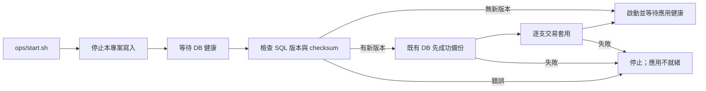

# 資料庫與本機維運

本文件供本機 demo 的維護者使用。操作入口是專案根目錄下的 `ops/setup.sh`、`ops/start.sh` 和 `ops/stop.sh`。會建立或修改資料的測試，必須使用**獨立 Compose 專案與資料卷**；以下日常命令不需要測試 fixture。

## 首次設定與日常啟停

需要 Docker Compose、OpenSSL，以及空出的本機 `8080`–`8093` port。從專案根目錄執行：

```sh
ops/setup.sh
```

`setup.sh` 會建立 `.env` 中的資料庫密碼和 Laravel 應用金鑰、`.local/keys/` 中十三份互不相同的 32-byte 隨機 JWT 金鑰（正規 Base64、權限 `0600`），然後啟動 DB、套用 SQL，透過互動輸入建立第一位管理員。管理員密碼由標準輸入送進容器，不放在命令列參數；沒有預設密碼。設定完成時腳本會等待十三個後端、Vue、Nuxt、React、Next.js、Angular、SvelteKit 六版前端及 NGINX 就緒，才留下完成標記。成功後開啟 [http://localhost:8080/](http://localhost:8080/)，根路徑會導向 Vue，預設後端為 Laravel。使用方式見[使用指南](user-guide.md)。

首次設定完成後使用下列日常命令。

```sh
ops/start.sh                 # DB → SQL → 十三後端、六前端、NGINX
ops/start.sh --without-rails  # 停用 Rails，等待十二後端、六前端、NGINX
ops/start.sh --backend-only  # 只啟動 DB、SQL 與後端
ops/stop.sh                  # 停容器，不刪 volume、金鑰、備份
docker compose ps            # 檢查服務狀態與 healthcheck
curl -i http://localhost:8081/up  # 以 Laravel 為例檢查 API 健康
```

`ops/start.sh` 會檢查 `.env`、所有金鑰與首次設定完成標記；缺少時停止。它先停止本專案的寫入服務，等 DB 健康、集中 SQL 入口成功後才啟動應用。`/up` 不是單純的 HTTP 存活訊號：後端需能查詢必要共用表，資料庫不可用時會回不可用狀態。`ops/stop.sh` 執行 Compose `down`，**不加 `-v`**。不要把 `docker compose down -v` 當成一般停止指令，它會刪除持久化資料卷。

一般模式將 Rails 納入必要健康檢查，不能在 Rails 未就緒時回報十三版成功。`--backend-only` 可與 `--without-rails` 組合，兩個選項順序不限；未知或重複參數會在操作 Docker 前被拒絕。`ops/setup.sh` 只支援原有的 `--backend-only` 選項。

既有十二版升級時，保留 `.env`、管理員及原十二份金鑰；`start.sh`／`setup.sh` 只在原十二份完整時明確執行一次 Rails 金鑰加入。私有 `.local/keys/.rails-initialized` 標記先建立，再以不可覆寫的方式落地 Rails key。若已有合法 Rails key，只採用原值並補標記。標記存在後，Rails key 遺失、毀損或權限不符會停止；初始化中斷也會保留標記並明確報錯，後續不自動產生另一把 key。請保留狀態並人工查核、恢復原檔；不要刪除標記來強迫重生。`ops/check-keys.sh` 無參數只檢查，不建立金鑰。金鑰與標記皆須為一般檔案、權限 `0600`。

首次設定若在產生金鑰後中斷，腳本會拒絕自動重生金鑰，避免已簽發的憑證與持久資料失去對應。先查看 `.env`、`.local/keys/`、容器和資料庫狀態，再決定如何恢復；不要為了重試而直接刪除資料或金鑰。重跑已完成的設定也不會替既有管理員換密碼，或把同 Email 的一般會員升級成管理員。

## 哪些資料會保留

| 位置 | 用途 | Git 狀態 |
| --- | --- | --- |
| Compose `postgres_data` volume | 帳號、文章、留言、登入與 SQL 版本 | 不在 Git |
| `.env` | DB owner／app 密碼、Laravel 應用金鑰 | `.gitignore` 排除 |
| `.local/keys/*.key`、`.local/keys/.rails-initialized` | 十三後端各自的 JWT 金鑰、Rails 一次性加入標記 | `.gitignore` 排除 |
| `.local/backups/` | SQL 更新前的 `pg_dump` 備份 | `.gitignore` 排除 |
| `database/sql/0001_*.sql` 至 `0009_*.sql` | 共用結構與更新腳本 | 專案程式碼 |

停止並重啟會保留資料與金鑰，不重新建立管理員，不延長既有 JWT 到期時間。備份只保留在本機；專案沒有自動異地備份或備份排程。JWT 金鑰、`.env` 和備份可能含敏感資料，不能放入版本控制或公開問題回報。

## 集中 SQL 更新如何運作

`ops/sql/apply.php` 是唯一的共用結構更新入口。它依檔名順序讀取 `database/sql/`，用 advisory lock 避免並行入口重複套用，並在 `schema_migrations` 保存每支檔案的版本、SHA-256 checksum 與套用時間。每支 SQL 與版本紀錄在同一交易提交；某支失敗時只回滾該支，已成功的先前版本保留。

| 版本 | 主要內容 |
| --- | --- |
| `0001` | 帳號表與基本角色／狀態 |
| `0002` | 登入紀錄、失敗事件與鎖定資料 |
| `0003` | 文章 |
| `0004` | 留言 |
| `0005` | 留言流程鎖定父文章所需的欄位權限 |
| `0006` | 文章／留言生命週期所需的欄位權限 |
| `0007` | 會員停用／恢復所需的狀態欄位權限 |
| `0008` | 更新共用鎖定設定三個數值欄位的權限 |
| `0009` | 登入紀錄、文章及留言來源允許 `rails`，不改既有版本 checksum |

新增結構應使用**新的版本檔**；不要修改已套用的 SQL，否則 checksum 不符會阻止啟動。資料庫已有未知表但沒有版本表、已有程式不認識的版本、或已套用檔案 checksum 改變，也會停止，不能悄悄覆蓋。

現有資料庫有待套用版本時，入口要求本專案寫入已停止（含 Rails），並先在 `.local/backups/` 成功建立非空的 PostgreSQL custom format `pg_dump`，之後才逐支交易套用。無待套用版本時不重複備份；首次空庫不做更新前備份。備份使用 `--no-owner`，仍保留原有 ACL；還原目標需要具備對應角色。應用連線角色 `articles_app` 沒有自行執行 DDL 的權限，十三個框架也不各自跑 migration。



SQL、備份或版本檢查失敗時，資料會保留，應用服務不會繼續啟動。先記下失敗階段，檢查備份檔、版本表和未成功的 SQL。

- 首次設定失敗且尚未有完成標記時，先確認既有設定及金鑰完整，排除原因後再執行 `ops/setup.sh`。若金鑰只建立了一部分，腳本會停下等待人工確認。
- 已完成首次設定的日常更新失敗時，修正未成功的版本或排除備份、連線等問題，再執行 `ops/start.sh`。

若需還原，先在具有原角色的**新目標資料庫**驗證備份、資料和 ACL，再另行決定是否切換；不要直接覆蓋現有展示資料。還原會影響後續新增資料，需由操作人員明確決定。

## Rails 故障與十二版暫用模式

Rails 單獨故障時，其他已就緒後端可繼續操作；它們簽發的有效登入不因 Rails 停止而改變。選用 Rails 的分頁顯示原有連線失敗提示，保留目前後端，使用者須自行改選其他後端並重新登入。沒有自動切換或換發 JWT。

維護者若要重新啟動整套服務但暫停 Rails，執行：

```sh
ops/start.sh --without-rails
# 排除 Rails 的故障原因後：
ops/start.sh
```

`--without-rails` 從全停或已有服務運作的狀態都會停住 Rails，等待其餘十二後端、六前端及 NGINX，並回報十二後端模式。啟動入口仍會先停本專案全部寫入、檢查 SQL，過程有短暫停機；它不是無中斷流量切換。此模式仍要求十三份金鑰及初始化標記有效，不能用它繞過金鑰損毀。Rails 原本建立的文章和留言保留 `created_backend: "rails"`，其餘後端可依原權限讀寫。

修復後使用一般入口恢復十三版；保留共用資料、設定、來源與所有金鑰，不重新灌資料或延長原登入期限。兩種入口都使用支援 `0009` 的集中 SQL 程式，保留版本、checksum 和升級前備份規則；不回退到只認得舊結構的程式，也不自動還原備份。

## 管理員密碼重設

已完成設定且 Laravel 容器就緒時，可使用 `app:reset-admin-password`。它只接受既有管理員，不新增帳號、不升級會員；密碼變更與該管理員的舊登入撤銷一起完成。下列範例在 **Bash** 執行，密碼不回顯，也不出現在命令列參數：

```bash
read -r -p '管理員 Email：' admin_email
read -r -s -p '新密碼：' admin_password
printf '\n'
printf '%s\n%s\n' "$admin_email" "$admin_password" | docker compose exec -T laravel php artisan app:reset-admin-password
unset admin_password admin_email
```

新密碼仍須符合 4–16 碼 ASCII 英數。指令失敗時先檢查輸入與 Laravel／DB 狀態，不能當成已重設成功。

## 排查起點

| 現象 | 先查什麼 |
| --- | --- |
| 提示尚未完成首次設定 | 是否真的完成 `ops/setup.sh`；檢查 `.env`、金鑰與完成標記，不自行偽造標記。 |
| 金鑰缺漏或損壞 | 停止啟動；找回原金鑰。自動重生會使原登入憑證失效。 |
| SQL checksum／未知版本錯誤 | 比對 `database/sql/` 與實際 DB 版本，保留現況；已套用檔案不可直接改。 |
| 備份目錄不可寫或 `pg_dump` 失敗 | 檢查 `.local/backups/`、空間與權限；備份成功前不繼續更新。 |
| 前端某一路徑不可用 | 先看 `docker compose ps`，再查看該前端與 `nginx` 日誌；其他前端可能仍可用。 |
| API `/up` 不可用 | 查看對應後端、`sql` 與 `db` 的狀態及日誌；不要把 DB 故障解釋成 JWT 過期。 |

需要精確 API 錯誤和權限時看[會員文章 API](article-api.md)；測試與已知驗證界線看[驗證紀錄](verification.md)。
